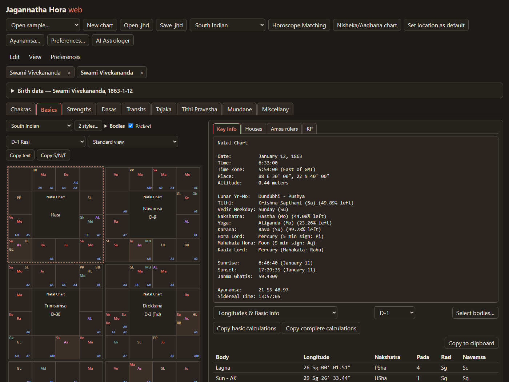

# Jagannatha Hora for the web

**A Vedic astrology consultation with an AI that calculates exactly like Jagannatha Hora.**

[](PARITY.md)
[](https://nodejs.org)
[](#mcp-server)
[](#about-the-project)

Ask Claude, ChatGPT (in OpenAI's Codex app) or Gemini (in Antigravity) about your chart, and it works from real calculations, not guesses. It casts your chart with the same calculations as **Jagannatha Hora 8.0**, P.V.R. Narasimha Rao's astrology program, and checks the chart against your past events before it answers. It then gives you a reading that quotes the data behind each point.

The project also includes the full Jagannatha Hora program as a web app that runs in your browser.



## Get a reading in a few minutes

The easiest way is to let an AI desktop app install the astrologer for you. You need a Mac or a Windows PC and one of these apps:

| App | Models | Get it |
|---|---|---|
| [![Claude desktop app][badge-claude]](https://claude.ai/download) | Claude | [claude.ai/download](https://claude.ai/download), then use its **Code** tab |
| [![Codex app (ChatGPT)][badge-codex]](https://developers.openai.com/codex/app) | ChatGPT's GPT models; sign in with your ChatGPT account | [developers.openai.com/codex/app](https://developers.openai.com/codex/app) |
| [![Antigravity (Gemini)][badge-antigravity]](https://antigravity.google) | Gemini | [antigravity.google](https://antigravity.google) |
| [![Cursor][badge-cursor]](https://cursor.com) | your choice of models | [cursor.com](https://cursor.com) |

[badge-claude]: https://img.shields.io/badge/Claude-desktop_app-D97757?style=for-the-badge&logo=claude&logoColor=white
[badge-codex]: https://img.shields.io/badge/Codex-ChatGPT-000000?style=for-the-badge&logo=data:image/svg%2bxml;base64,PHN2ZyBmaWxsPSJ3aGl0ZSIgcm9sZT0iaW1nIiB2aWV3Qm94PSIwIDAgMjQgMjQiIHhtbG5zPSJodHRwOi8vd3d3LnczLm9yZy8yMDAwL3N2ZyI+PHRpdGxlPk9wZW5BSTwvdGl0bGU+PHBhdGggZD0iTTIyLjI4MTkgOS44MjExYTUuOTg0NyA1Ljk4NDcgMCAwIDAtLjUxNTctNC45MTA4IDYuMDQ2MiA2LjA0NjIgMCAwIDAtNi41MDk4LTIuOUE2LjA2NTEgNi4wNjUxIDAgMCAwIDQuOTgwNyA0LjE4MThhNS45ODQ3IDUuOTg0NyAwIDAgMC0zLjk5NzcgMi45IDYuMDQ2MiA2LjA0NjIgMCAwIDAgLjc0MjcgNy4wOTY2IDUuOTggNS45OCAwIDAgMCAuNTExIDQuOTEwNyA2LjA1MSA2LjA1MSAwIDAgMCA2LjUxNDYgMi45MDAxQTUuOTg0NyA1Ljk4NDcgMCAwIDAgMTMuMjU5OSAyNGE2LjA1NTcgNi4wNTU3IDAgMCAwIDUuNzcxOC00LjIwNTggNS45ODk0IDUuOTg5NCAwIDAgMCAzLjk5NzctMi45MDAxIDYuMDU1NyA2LjA1NTcgMCAwIDAtLjc0NzUtNy4wNzI5em0tOS4wMjIgMTIuNjA4MWE0LjQ3NTUgNC40NzU1IDAgMCAxLTIuODc2NC0xLjA0MDhsLjE0MTktLjA4MDQgNC43NzgzLTIuNzU4MmEuNzk0OC43OTQ4IDAgMCAwIC4zOTI3LS42ODEzdi02LjczNjlsMi4wMiAxLjE2ODZhLjA3MS4wNzEgMCAwIDEgLjAzOC4wNTJ2NS41ODI2YTQuNTA0IDQuNTA0IDAgMCAxLTQuNDk0NSA0LjQ5NDR6bS05LjY2MDctNC4xMjU0YTQuNDcwOCA0LjQ3MDggMCAwIDEtLjUzNDYtMy4wMTM3bC4xNDIuMDg1MiA0Ljc4MyAyLjc1ODJhLjc3MTIuNzcxMiAwIDAgMCAuNzgwNiAwbDUuODQyOC0zLjM2ODV2Mi4zMzI0YS4wODA0LjA4MDQgMCAwIDEtLjAzMzIuMDYxNUw5Ljc0IDE5Ljk1MDJhNC40OTkyIDQuNDk5MiAwIDAgMS02LjE0MDgtMS42NDY0ek0yLjM0MDggNy44OTU2YTQuNDg1IDQuNDg1IDAgMCAxIDIuMzY1NS0xLjk3MjhWMTEuNmEuNzY2NC43NjY0IDAgMCAwIC4zODc5LjY3NjVsNS44MTQ0IDMuMzU0My0yLjAyMDEgMS4xNjg1YS4wNzU3LjA3NTcgMCAwIDEtLjA3MSAwbC00LjgzMDMtMi43ODY1QTQuNTA0IDQuNTA0IDAgMCAxIDIuMzQwOCA3Ljg3MnptMTYuNTk2MyAzLjg1NThMMTMuMTAzOCA4LjM2NCAxNS4xMTkyIDcuMmEuMDc1Ny4wNzU3IDAgMCAxIC4wNzEgMGw0LjgzMDMgMi43OTEzYTQuNDk0NCA0LjQ5NDQgMCAwIDEtLjY3NjUgOC4xMDQydi01LjY3NzJhLjc5Ljc5IDAgMCAwLS40MDctLjY2N3ptMi4wMTA3LTMuMDIzMWwtLjE0Mi0uMDg1Mi00Ljc3MzUtMi43ODE4YS43NzU5Ljc3NTkgMCAwIDAtLjc4NTQgMEw5LjQwOSA5LjIyOTdWNi44OTc0YS4wNjYyLjA2NjIgMCAwIDEgLjAyODQtLjA2MTVsNC44MzAzLTIuNzg2NmE0LjQ5OTIgNC40OTkyIDAgMCAxIDYuNjgwMiA0LjY2ek04LjMwNjUgMTIuODYzbC0yLjAyLTEuMTYzOGEuMDgwNC4wODA0IDAgMCAxLS4wMzgtLjA1NjdWNi4wNzQyYTQuNDk5MiA0LjQ5OTIgMCAwIDEgNy4zNzU3LTMuNDUzN2wtLjE0Mi4wODA1TDguNzA0IDUuNDU5YS43OTQ4Ljc5NDggMCAwIDAtLjM5MjcuNjgxM3ptMS4wOTc2LTIuMzY1NGwyLjYwMi0xLjQ5OTggMi42MDY5IDEuNDk5OHYyLjk5OTRsLTIuNTk3NCAxLjQ5OTctMi42MDY3LTEuNDk5N1oiLz48L3N2Zz4=
[badge-antigravity]: https://img.shields.io/badge/Antigravity-Gemini-4285F4?style=for-the-badge&logo=googlegemini&logoColor=white
[badge-cursor]: https://img.shields.io/badge/Cursor-any_model-000000?style=for-the-badge&logo=cursor&logoColor=white

**ChatGPT users:** the ChatGPT chat app can only use tools hosted on the internet, not one running on your own computer. Use OpenAI's **Codex app** instead. It signs in with the same ChatGPT account and can both install the astrologer and use it.

None of these apps? You can still use the [web app's AI astrologer](#no-desktop-ai-app-use-the-web-app) with an API key.

### 1. Let your AI app set it up

Paste this into the app: in the Claude desktop app, the **Code** tab; in Codex, a new thread; in Antigravity, the agent panel; in Cursor, the agent chat.

```text
Set up the Jagannatha Hora astrologer for me: clone https://github.com/whym3/jhora-ai
into my Documents folder, install Node.js 22 or newer if it isn't installed, and run
npm install. Then connect its local MCP server to this app:
- Claude desktop app: run npm run setup:claude
- Codex app: run npm run setup:print and add the printed "jhora" server to
  ~/.codex/config.toml as [mcp_servers.jhora] with the same command and args
- any other app: run npm run setup:print and add the printed "jhora" server to
  this app's MCP settings
Keep my other settings. Tell me when to restart the app.
```

It downloads the project, installs what it needs and connects the astrologer, keeping any other settings you have.

### 2. Restart the app

Restart the app when it tells you to. Quit it completely, then open it again. On a Mac, use the app's menu, for example **Claude → Quit Claude**. On Windows, right-click its icon in the taskbar's notification area and choose **Quit**.

### 3. Start a new chat

Say:

> I'd like a Vedic astrology consultation.

<details>
<summary>Setting it up by hand instead</summary>

1. Install [Node.js](https://nodejs.org) (the **LTS** version).
2. Download the project ([**Download ZIP**](https://github.com/whym3/jhora-ai/archive/refs/heads/master.zip)) and unzip it somewhere you'll keep it.
3. Open a terminal in that folder. On a Mac, open **Terminal**, type `cd ` (with a space), drag the folder onto the window and press Return. On Windows, right-click inside the folder in File Explorer and choose **Open in Terminal**.
4. Run `npm install`, then connect the server to your app:
   - **Claude desktop app:** `npm run setup:claude`
   - **Codex app:** run `npm run setup:print` and add its `command` and `args` to `~/.codex/config.toml` (on Windows, `%USERPROFILE%\.codex\config.toml`):
     ```toml
     [mcp_servers.jhora]
     command = "/full/path/to/node"
     args = ["/full/path/to/jhora-ai/dist-mcp/jhora-mcp.mjs"]
     ```
   - **Antigravity:** open the **…** menu in the agent panel, choose **MCP Servers → Manage MCP Servers → View raw config**, and paste the `"jhora"` entry that `npm run setup:print` prints inside `"mcpServers"`.
   - **Cursor and other MCP apps:** paste the `"jhora"` entry that `npm run setup:print` prints into the app's MCP settings (for Cursor, `~/.cursor/mcp.json`). See [MCP server](#mcp-server).

</details>

### No desktop AI app? Use the web app

If none of the desktop apps above is available, use the AI astrologer built into the web app. It runs the same calculations. It needs an API key from Anthropic ([console.anthropic.com](https://console.anthropic.com)) or OpenAI ([platform.openai.com](https://platform.openai.com)). API use is billed by the provider separately from a Claude or ChatGPT subscription.

1. Install [Node.js](https://nodejs.org) (the **LTS** version), download the project and open a terminal in its folder, as in steps 1-3 of *Setting it up by hand* above.
2. Run `npm install`, then `npm run dev`, and open [http://localhost:5173](http://localhost:5173) in your browser.
3. Open or enter the chart, click **AI Astrologer**, choose Claude or OpenAI and paste your key. The key is stored only in your browser.

See [The web app](#the-web-app) and [AI astrologer](#ai-astrologer) for more.

### What happens in a consultation

1. **Your chart.** The AI asks whose chart it is and for the birth date, time and place. It works out the place's coordinates and time zone, shows them for you to confirm, and saves the chart so it is there next time.
2. **Your past events.** Before any prediction, it asks for a few dated events from your life: studies, jobs, marriage, children, moves, illnesses, losses. It checks them against the planetary periods (dasas) running at the time, to make sure the chart and birth time fit your life.
3. **Your question.** Then ask anything: career, money, relationships, health, the year ahead. The answer draws on the dasas, transits, yogas, divisional charts and more, and says which data each point comes from.

You can also ask directly, for example *"What dasa am I running now?"*, *"When does Saturn enter my 10th house?"* or *"Cast a prasna for the number 37."*

### Best models for accurate readings

The calculations are exact whatever model you use, but the reading is only as good as the model interpreting them. Readings are most accurate with a top model at **high thinking**:

| App | Model | Setting |
|---|---|---|
| Claude desktop app | **Fable 5.1** | extended thinking on |
| Codex app (ChatGPT) | **the latest GPT model** | reasoning effort high |
| Antigravity (Gemini) | **Gemini Argon** | high thinking |
| Web app's AI astrologer (OpenAI key) | **the latest GPT model** | reasoning effort high |

Smaller or faster models can mix up chart details or skip steps of the method.

**Privacy.** Every calculation runs on your computer. Your conversation goes to the AI's provider (Anthropic, OpenAI or Google) like any other chat with it. Saved charts stay in the project's `charts` folder.

**If the app doesn't offer the tools,** check its MCP settings (in Claude, **Settings → Developer**; in Codex, `~/.codex/config.toml`): "jhora" should be listed. If you moved or renamed the project folder, ask the app to connect it again. Gemini's own desktop app did not give the tools to its model in testing; use Antigravity for Gemini.

### What the AI can look up

These are the tools the MCP server gives the AI. The calculations behind them are exact, so the AI never has to guess a position or a date.

**Consultation** (desktop apps only)

| Tool | What it does |
|---|---|
| `start_consultation` | Called first in every new chat. Returns the consultation steps to follow, your saved charts and what has been done so far. |
| `list_saved_charts` | Your saved charts, then the sample charts of well-known people. |
| `open_chart` | Opens the chart the other tools work on: a saved or sample chart, a Jagannatha Hora `.jhd` file, or new birth details, which can be saved for next time. It also sets the gender (for Nadi readings), the house system and true or mean nodes. |
| `record_life_events` | Records dated events from your past and gives the Vimsottari maha, antar and pratyantar dasa running at each, to test the chart and birth time. |

**The birth chart**

| Tool | What it does |
|---|---|
| `get_chart_overview` | Birth data and Key Info: tithi, nakshatra, yoga, karana, sunrise and sunset, hora lord, ayanamsa, and the calculation settings in use. |
| `get_longitudes` | Exact positions of the 56 bodies (planets, lagna, special lagnas, upagrahas, arudhas, sphutas) with nakshatra, pada, sign, navamsa, retrogression and chara karakas. |
| `get_divisional_charts` | The sign of every body in every divisional chart (D-1 to D-60, D-81, D-108, D-144) at once. |
| `get_divisional_longitudes` | The exact degree of every body in every divisional chart. |
| `get_houses_and_kp` | House cusps and the planets in each house, KP star, sub and deeper lords of every cusp and planet, and which planets sit in each planet's nakshatra. |
| `get_special_points` | Chara karakas, taras, yogi and avayogi, combustion, planetary war, sahamas, drekkanas, special tithis, pushkara and mrityu bhaga, deities, D-60 amsa names, declinations, Laghu Parasari functional benefics and malefics. |
| `get_sign_change_sensitivity` | How much earlier or later the birth time would have to be for a body to change sign in a divisional chart, for birth-time rectification. |
| `get_nisheka_chart` | The conception (Nisheka) chart and gestation period, with Vimsottari compressed into it. |
| `get_calculations_report` | Jagannatha Hora's full "Copy basic" or "Copy complete calculations" report as one text. |

**Dasas (planetary periods)**

| Tool | What it does |
|---|---|
| `get_dasa` | The periods of any of 49 dasa systems (Vimsottari, Yogini, Narayana, Chara, Kalachakra ...), down to five levels. |
| `get_running_dasa` | The periods running on a given date, from maha dasa down. |
| `get_dasa_periods_in_range` | Every period that overlaps a date range, for timing windows such as "which antardasas run from 2026 to 2030". |
| `get_dasa_period_chart` | The chart cast for the moment a period begins, read for what the period brings. |
| `get_dasa_transits` | When Jupiter, Saturn, Rahu and Ketu move through each house counted from a period's sign, to time events within the period. |
| `get_dasa_details` | Jagannatha Hora's notes on what a dasa is and when to use it, or the sum of the period lords' longitudes. |

**Strengths, yogas and aspects**

| Tool | What it does |
|---|---|
| `get_strengths` | Shadbala, bhava bala, ishta and kashta phala, rashmis, vimsopaka bala, vaiseshikamsas, avasthas and the Tajaka balas. |
| `get_strength_graphs` | The numbers behind Jagannatha Hora's strength bar graphs. |
| `get_ashtakavarga` | Bhinnashtakavarga and sarvashtakavarga, the reduced (sodhita) and prastara forms, and the sodhya pindas. |
| `get_yogas` | The yogas present in the chart or a divisional chart, with the planets forming them and their results. |
| `get_supported_yogas` | Every yoga Jagannatha Hora checks, present or not, with its definition and results. |
| `get_aspects` | Parasara aspect strengths of each planet on every body and house, and the relationship (friend, enemy ...) of each planet to the others. |
| `get_argala_and_rasi_drishti` | Jaimini sign aspects (rasi drishti) and argala (intervention) on each house, for use with the Jaimini rasi dasas. |

**Transits and timing**

| Tool | What it does |
|---|---|
| `get_transits` | Planetary positions on a date against the natal chart, in Jagannatha Hora's transit modes: houses, taras, vedha, ashtakavarga bindus, special nakshatras, aspects and latta. |
| `get_transit_search` | The exact moment a planet reaches a natal point, a sahama or the start of a sign, for example Saturn entering Pisces or Jupiter crossing the natal Moon. |
| `get_transit_calendar` | Day-by-day (or week-by-week) transit scores of the nine planets, to scan weeks or months for good and bad stretches. |
| `get_transit_correlation` | Which natal points each transiting planet strikes on a date, across the main divisional charts. |
| `get_chakra` | The Sarvatobhadra, Kota, Sudarsana, Surya and Chandra Kalanala, Shoola and Tripataki chakras, with natal or transit planets placed in them. |
| `get_month_ephemeris` | A month's sign and nakshatra ingresses and planetary aspects, a daily ephemeris, or a daily panchanga. |
| `get_panchanga` | The panchanga of a day: tithi, nakshatra, yoga and karana with end times, sunrise, moonrise, rahu kaala, varjya, durmuhurta, horas and choghadiyas. |

**Other charts**

| Tool | What it does |
|---|---|
| `get_annual_chart` | The Tajaka annual chart (varshaphala) or a monthly chart, with its Mudda dasa. |
| `get_tithi_pravesha` | The Tithi Pravesha chart for a year, lunar month or day of life. |
| `get_progressed_chart` | Progressed charts: solar, Bhrigu, Sudarsana chakra and nakshatra-dasa progressions. |
| `get_angular_return` | The next moment the angle between two bodies returns to its birth value (Sun to Moon gives a tithi return). |
| `get_prasna_chart` | A horary (prasna) chart from a number the querent gives: 1-108, KP 1-249, or Nadi 1-1800. |
| `get_mundane_chart` | Event charts: a planet entering a sign, two planets forming an aspect, a station, an eclipse, a solar or lunar new year or month, or Ardra Pravesha. |
| `get_marriage_match` | Ashta koota marriage matching from both Moon nakshatras: the score out of 36 and the level of match. |

The web app's AI astrologer uses the same 36 `get_` tools; the four consultation tools belong to the MCP server. The server also offers a `jyotish_reading` prompt that starts a consultation.

---

## About the project

A browser port of **Jagannatha Hora 8.0** that reproduces its calculations exactly, with an **AI astrologer** that reads charts through those calculations, and an **MCP server** that gives the same tools to Claude and other AI apps.

Everything runs locally: the Swiss Ephemeris is compiled to WebAssembly and runs in the browser (or in Node for the MCP server). Nothing about a chart leaves your machine unless you use the AI features.

## Features

- **Charts:** rasi and every divisional chart (D-1 to D-60, D-81, D-108, D-144), South or North Indian style, 56 bodies (special lagnas, upagrahas, arudhas, sphutas), houses in eleven systems, and KP lords down to the deha-sub.
- **Dasas:** Vimsottari and 48 other nakshatra, rasi and graha dasas, five levels deep.
- **Strengths and yogas:** Shadbala, Bhava bala, Ishta/Kashta, Vimsopaka, Ashtakavarga (with sodhana and pindas), avasthas, Tajaka balas, and JHora's full yoga set.
- **Timing:** transits (nine modes, transit calendar, special search), Tajaka annual and monthly charts with Mudda dasa, Tithi Pravesha, progressions, angular returns, Prasna and mundane charts.
- **Also:** panchanga, chakras (Sudarsana, Kota, Sarvatobhadra, Kalachakra, Shoola, Tripataki and more), horoscope matching, Laghu Parasari, and the Surya Siddhanta planetary model.
- **Files:** reads and writes JHora's `.jhd` files; JHora's place atlas is optional.

## Accuracy

The port is tested against Jagannatha Hora's own output: **all 3690** comparisons match. The test data covers 18 charts and every tab, plus mundane, progression and prasna charts, marriage matching for every nakshatra and pada, and the chart styles. It was captured from the desktop program by [tools/harness](tools/harness/README.md). See [PARITY.md](PARITY.md) for the breakdown by area and the documented tolerances. Sixteen tests of option variants are skipped until JHora's output for those settings is captured.

## The web app

The full program, with JHora's tabs and charts, in your browser. You need Node.js 22 or newer.

```bash
npm install
npm run dev        # then open http://localhost:5173
```

**Ephemeris files.** The Swiss Ephemeris data files in `public/ephe` are included, and they are JHora 8.0's own copies. That matters: JHora ships an older build of these files, and only the same files reproduce its output exactly. Compared with JHora's results across the test suite:

| Files in `public/ephe` | Tests that differ from JHora |
|---|---:|
| JHora's own copies (included) | 0 |
| Astrodienst's current official files | 314 |
| none (Swiss Ephemeris falls back to its Moshier approximation) | 844 |

To refresh them from an installation, run `JHORA_DIR="/path/to/Jagannatha Hora" bash tools/copy-ephe.sh`. The default `JHORA_DIR` is the Windows location; on a Mac running JHora through Wine or Whisky, it is the `drive_c/Program Files (x86)/Jagannatha Hora` folder inside the bottle.

**Place search (optional).** JHora's atlas lets you search birth places by name; it is not included. Copy it with `node tools/atlas/install.mjs "/path/to/Jagannatha Hora/jhcore/atlas"`.

## AI astrologer

The **AI Astrologer** button opens a chat about the chart on screen, using Claude or OpenAI with your own API key. Keys are stored only in your browser and sent only to the provider you choose.

The model doesn't guess positions or dates: it reads the chart through 36 tools that run the app's calculations. These cover:
- positions, divisional charts, and houses and KP
- dasas, with each period's entry chart and the slow planets' transits through it, JHora's dasa options (Chara seed from Lagna, Sun or Moon, the varga of Drigdasa, Trikona, Chara and Yogardha, the Kalachakra method), Quick Info and sum of longitudes
- strengths (with the bar-graph numbers), yogas present and every supported yoga's definition, and Parasara aspects
- Jaimini rasi drishti and argala
- transits, exact ingress and conjunction moments, and natal points struck in transit
- chakras: Sarvatobhadra (vedhas on the special nakshatras), Kota, Sudarsana, Surya and Chandra Kalanala, Shoola, Tripataki
- monthly planetary movements, ephemeris and panchanga
- Tajaka, Tithi Pravesha and angular-return charts
- progressed charts (solar, Bhrigu, Sudarsana chakra, nakshatra dasa, including Kalachakra with any calculation method) and the Nisheka (conception) chart
- prasna (108, KP 249, Nadi), and mundane and prasna charts with their compressed Vimsottari
- mundane event charts (ingresses, aspects, stations, eclipses, solar and lunar new years and months, Ardra Pravesha)
- marriage matching and panchanga
- JHora's "Copy basic / complete calculations" report

Its readings work through three layers (Parashari with Jaimini, KP, and Bhrigu Nandi Nadi) and quote the data behind each statement. The prompt and tools are in [src/ai](src/ai).

## MCP server

The same 36 tools are available to any [Model Context Protocol](https://modelcontextprotocol.io) client, alongside the server's own chart and consultation tools. Each conversation runs as a consultation:

1. **The chart.** The assistant offers your saved charts, or takes birth details and saves them for next time.
2. **Past events.** It asks for a few dated events from your life and checks them against the dasas running at the time, to test the chart and birth time.
3. **Your question.** Only then does it read the chart for what you want to know.

Build it once (rebuild after code changes):

```bash
npm run mcp:build          # -> dist-mcp/jhora-mcp.mjs (self-contained, no node_modules needed)
```

The server needs the ephemeris files in `public/ephe` (see [The web app](#the-web-app)). It reads charts from `public/samples` and saves your own charts in `charts/`, which git ignores.

### Claude Desktop, Cursor and other local clients

Let the client launch the server itself. For Claude Desktop, `npm run setup:claude` builds the server and adds it to Claude's config (`--dry-run` shows the change without writing it; `--config <file>` picks the file). To do it by hand, add this to `claude_desktop_config.json` (**Settings → Developer → Edit Config**), then restart Claude:

```json
{
  "mcpServers": {
    "jhora": {
      "command": "node",
      "args": ["/absolute/path/to/jhora-ai/dist-mcp/jhora-mcp.mjs"]
    }
  }
}
```

Desktop apps may not see your shell's `PATH`; if the server doesn't start, give the full path to `node` (for example `/opt/homebrew/bin/node`). Cursor uses the same block in `~/.cursor/mcp.json`.

For Claude Code:

```bash
claude mcp add --scope user jhora -- node /absolute/path/to/jhora-ai/dist-mcp/jhora-mcp.mjs
```

Then just ask, for example *"I'd like a reading: open my saved chart"* or *"what dasa am I running now?"*. The server also offers a `jyotish_reading` prompt.

### As a standalone HTTP or HTTPS server

```bash
npm run mcp:http           # http://127.0.0.1:3333/mcp
npm run mcp:https          # https://localhost:3443/mcp
```

HTTPS needs a certificate for `localhost`, for example made with [mkcert](https://github.com/FiloSottile/mkcert):

```bash
mkdir -p .cache/mcp-tls
mkcert -cert-file .cache/mcp-tls/cert.pem -key-file .cache/mcp-tls/key.pem localhost 127.0.0.1
```

Both modes listen on this machine only and refuse requests addressed to any other host name. They are not yet safe to expose publicly: see [Limitations](#limitations).

### Docker

```bash
docker compose up -d --build    # https://localhost:3443/mcp
```

This builds the server into a Node 22 image and publishes it on `127.0.0.1` only. Saved charts stay in `./charts` on the host, and the certificate from `.cache/mcp-tls` is mounted read-only, never copied into the image. The image includes the ephemeris files.

### Settings

| Variable | Default | Meaning |
|---|---|---|
| `JHORA_ROOT` | the repository holding the server file | where `public/ephe` and `public/samples` are |
| `JHORA_CHARTS` | `charts/` | saved charts |
| `JHORA_MCP_LOG` | `charts/.jhora-mcp.log` | short log of every request, for clients whose own logs are unreadable |
| `JHORA_MCP_HOST` | `127.0.0.1` | listen address for HTTP/HTTPS (`0.0.0.0` in Docker) |
| `JHORA_TLS_CERT`, `JHORA_TLS_KEY` | `.cache/mcp-tls/cert.pem`, `key.pem` | certificate for HTTPS |

### Limitations

- **Not ready for public hosting.** The server is built for one person: every visitor would see the same saved charts, `open_chart` accepts file paths on the host, and each session loads its own copy of the calculation engine.
- **Cloud connectors can't reach it.** Claude's "custom connector" and Gemini's "Cloud MCP" connect from their providers' servers, which cannot reach a server on `localhost`.
- **Gemini's desktop app:** in testing, Gemini's local-server support did not offer the tools to its model.

## Development

| Command | What it does |
|---|---|
| `npm run dev` | the web app with live reload |
| `npm test` | all tests (Vitest) |
| `npm run typecheck` | TypeScript checks |
| `npm run build` | production build of the web app into `dist/` (works offline as a PWA) |
| `npm run parity` | regenerate PARITY.md from the test results |
| `npm run mcp:build` | build the MCP server |
| `npm run setup:claude` | build the MCP server and register it with the Claude desktop app |
| `npm run setup:print` | build the MCP server and print its config block for other apps (Antigravity, Cursor ...) |

The tests compare the port with JHora's output in `golden/`. `JHORA_EPHE_DIR=/some/folder npm test` runs them against another set of ephemeris files.

**Swiss Ephemeris engine.** It is built from Astrodienst's official source (v2.10.3) with Emscripten, plus small patches that emulate the DLL bundled with JHora. Rebuild it with `tools/build-sweph.sh`, which needs Docker.

**Golden data.** It comes from running the desktop program under automation; see [tools/harness](tools/harness/README.md).

### Layout

| Path | Contents |
|---|---|
| `src/core` | all calculations: positions, vargas, dasas, strengths, yogas, KP, transits, Tajaka, chakras, derived charts |
| `src/sweph` | typed wrapper around the Swiss Ephemeris WebAssembly build |
| `src/engine` | the calculation worker and its jobs (the tables every view and tool requests) |
| `src/ui` | the React interface |
| `src/ai` | the AI astrologer: system prompt, tools, Claude and OpenAI adapters |
| `src/mcp` | the MCP server |
| `golden` | sample charts and JHora's output for them |
| `tests` | Vitest suites |
| `tools` | ephemeris and atlas copying, engine build, test harness, parity report |

## Licence and credits

All astrological methods and the program's behaviour come from **Jagannatha Hora** by P.V.R. Narasimha Rao. This project reproduces its calculations so they can run on any platform; it is not affiliated with or endorsed by the author.

The ephemeris engine is the **Swiss Ephemeris** by Astrodienst AG, which is dual-licensed: under the GNU Affero General Public License (AGPL), or under Astrodienst's professional licence. Using this code, and especially running it as a public network service, has to follow one of the two.

This repository does not yet have a licence of its own.
